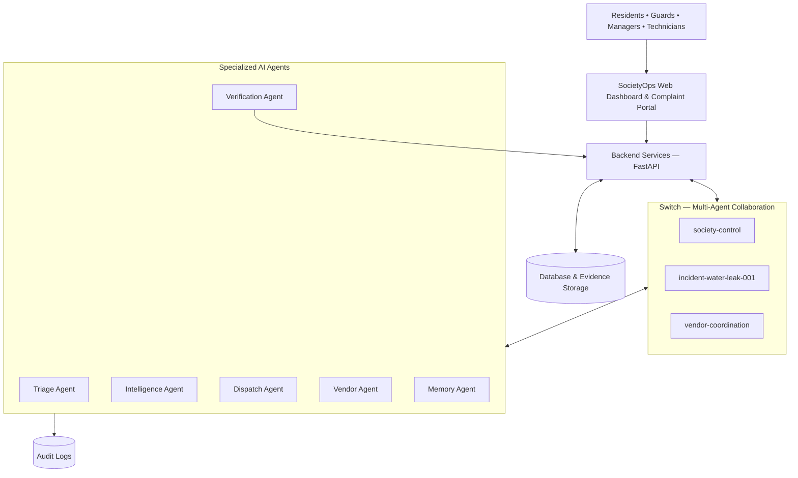

# 🏙️ SocietyOps — The Autonomous Society Operations Network

### Don't just report problems. Resolve them together.

**SocietyOps** is an AI-powered, multi-agent residential society operations platform designed to transform how residential communities manage complaints, coordinate maintenance, communicate with vendors, and verify issue resolution.

Instead of treating every complaint as an isolated ticket, SocietyOps brings specialized AI agents, residents, technicians, vendors, and society managers together in a collaborative operations network powered by **Switch**.

## 🌟 The Problem

Residential societies often face operational challenges:

- Complaints get delayed or lost between residents and management.
- Multiple reports about the same issue are handled separately.
- Technician and vendor coordination is time-consuming.
- Managers lack visibility into ongoing incidents.
- Issues are sometimes marked resolved without proper verification.
- Recurring maintenance problems are difficult to identify.

## 💡 Our Solution

SocietyOps introduces an intelligent, collaborative workflow where AI agents help investigate, coordinate, and track society incidents from reporting to verified resolution.

The platform combines AI-powered intelligence with human approvals to make society operations more transparent, efficient, and accountable.

## ✨ Key Features

### 1. 🤖 AI-Powered Incident Triage
Automatically analyzes incoming complaints, categorizes incidents, and helps determine their priority.

### 2. 🧠 AI Incident Detective
Correlates multiple complaints based on location, time, and description to identify possible common causes.

### 3. 🔄 Multi-Agent Collaboration with Switch
Specialized AI agents collaborate through shared Switch rooms, exchanging updates and coordinating operational tasks.

### 4. 🚚 Smart Dispatch Coordination
Helps coordinate technician assignments and maintenance activities.

### 5. 🏢 Vendor Coordination
Supports vendor availability and quotation comparison to assist management decisions.

### 6. ✅ Evidence-Based Resolution Verification
Tracks technician evidence and verification status before an incident is considered resolved.

### 7. 🛡️ Human-in-the-Loop Approvals
Keeps society managers involved in important decisions such as dispatch, vendor selection, expenses, and incident closure.

### 8. 📊 Society Intelligence
Helps identify recurring incidents, maintenance patterns, and operational risks.

### 9. 📝 Audit Trail
Maintains an operational history of incidents, decisions, agent activities, and resolution updates.

## 🏗️ System Architecture

The architecture consists of five major layers:

1. **Presentation Layer:** Society dashboard, resident complaint portal, and manager approval center.
2. **Backend Layer:** FastAPI services for incidents, dispatch, approvals, evidence, and intelligence.
3. **Switch Collaboration Layer:** Shared rooms that enable communication between specialized AI agents.
4. **Autonomous Agent Layer:** Triage, Intelligence, Dispatch, Vendor, Verification, and Memory agents.
5. **Data Layer:** Database, evidence storage, and audit logs.



## 🔄 How SocietyOps Works

**Example: Water Leakage in Block B**

1. A resident reports water leakage in apartment B-204.
2. The Triage Agent analyzes the complaint and assigns a priority.
3. The Intelligence Agent checks whether other complaints, such as a damp ceiling in B-304 or water in the lobby, may be related.
4. Agents share findings through the relevant Switch room.
5. The Dispatch Agent helps coordinate a technician.
6. The Vendor Agent assists with vendor coordination when required.
7. The society manager reviews and approves consequential decisions.
8. The technician submits resolution evidence.
9. The Verification Agent checks the submitted evidence.
10. The incident moves towards closure after the required verification and approval.

**Result:** A collaborative, traceable workflow instead of disconnected complaint handling.

## 🔌 Why Switch?

Switch is the collaboration infrastructure at the heart of SocietyOps.

Rather than relying on isolated AI functions, SocietyOps uses shared rooms to enable specialized agents to communicate and coordinate their work.

**Proposed Switch Rooms:**

| Room | Purpose |
|---|---|
| `society-control` | Overall operational coordination |
| `incident-water-leak-001` | Incident-specific investigation |
| `vendor-coordination` | Vendor and maintenance coordination |
| `resolution-review` | Evidence and closure review |

Switch enables agents and humans to work together in a shared communication environment.

## 🧰 Technology Stack

| Layer | Technology |
|---|---|
| Frontend | Next.js, React, TypeScript |
| Styling | Tailwind CSS |
| UI Components | shadcn/ui, Lucide |
| Animations | Framer Motion |
| Backend | Python, FastAPI |
| Data Validation | Pydantic |
| Database | SQLite / PostgreSQL |
| AI | Configurable LLM provider |
| Agent Collaboration | Switch |
| Version Control | Git & GitHub |

*Update this table to match the technologies actually implemented in the final build.*

## 🚀 Getting Started

### Prerequisites

- Node.js and npm
- Python 3.10+
- Git
- Docker Desktop (for a local Switch setup)
- A configured AI provider/API key, if required by your implementation
- Switch Console and an authenticated supported agent provider

### 1. Clone the Repository

```bash
git clone https://github.com/Tanya-garg10/societyops-ai.git
cd societyops-ai
```

### 2. Configure the Backend

```bash
cd backend
python -m venv venv
```

Activate the environment on Windows:

```powershell
.\venv\Scripts\Activate.ps1
```

Install dependencies:

```bash
pip install -r requirements.txt
```

Configure environment variables using the provided `.env.example` file.

Start the backend:

```bash
uvicorn main:app --reload
```

### 3. Configure the Frontend

Open a new terminal:

```bash
cd frontend
npm install
npm run dev
```

### 4. Configure Switch

1. Install and start Switch Console.
2. Configure a supported agent provider.
3. Install and authenticate the Switch connector as required.
4. Onboard the SocietyOps agents.
5. Create the required shared rooms.
6. Configure the application to use your actual Switch setup.

Refer to the official documentation:

- [Switch Documentation](https://docs.switchagents.ai/)
- [Switch GitHub Repository](https://github.com/sandbox-quantum/switch)
- [Switch Getting Started](https://www.switchagents.ai/get-started)

*Note: Follow the actual project configuration and agent onboarding instructions. Switch does not bundle the underlying AI models.*

## 🔐 Responsible AI & Human Oversight

SocietyOps is designed around responsible automation:

- Important operational actions require human approval.
- AI-generated root-cause suggestions are treated as hypotheses until verified.
- Evidence is required for resolution verification.
- Operational actions should be traceable through audit logs.
- Sensitive resident information should only be accessible to authorized users.
- Critical emergencies must follow appropriate emergency escalation procedures rather than relying solely on AI coordination.

## 🌍 Impact

SocietyOps aims to create:

- Faster incident response
- Better communication between stakeholders
- More transparent maintenance operations
- Improved accountability
- Smarter preventive maintenance
- More reliable residential communities

## 🔮 Future Scope

- WhatsApp and Telegram-based resident reporting
- Multilingual voice-based complaint registration
- Predictive maintenance using historical incident data
- IoT-based water leakage and equipment monitoring
- Advanced society risk heatmaps
- Resident feedback and satisfaction analytics
- Integration with real vendor and facility-management systems

Our goal is to demonstrate how collaborative AI agents can move beyond answering questions and help coordinate real-world operational workflows.

## 👩‍💻 Built By

**Tanya Garg**

### SocietyOps

**Don't just report problems. Resolve them together.** 🏙️

*Building smarter, more connected, and more accountable residential communities with collaborative AI.*
